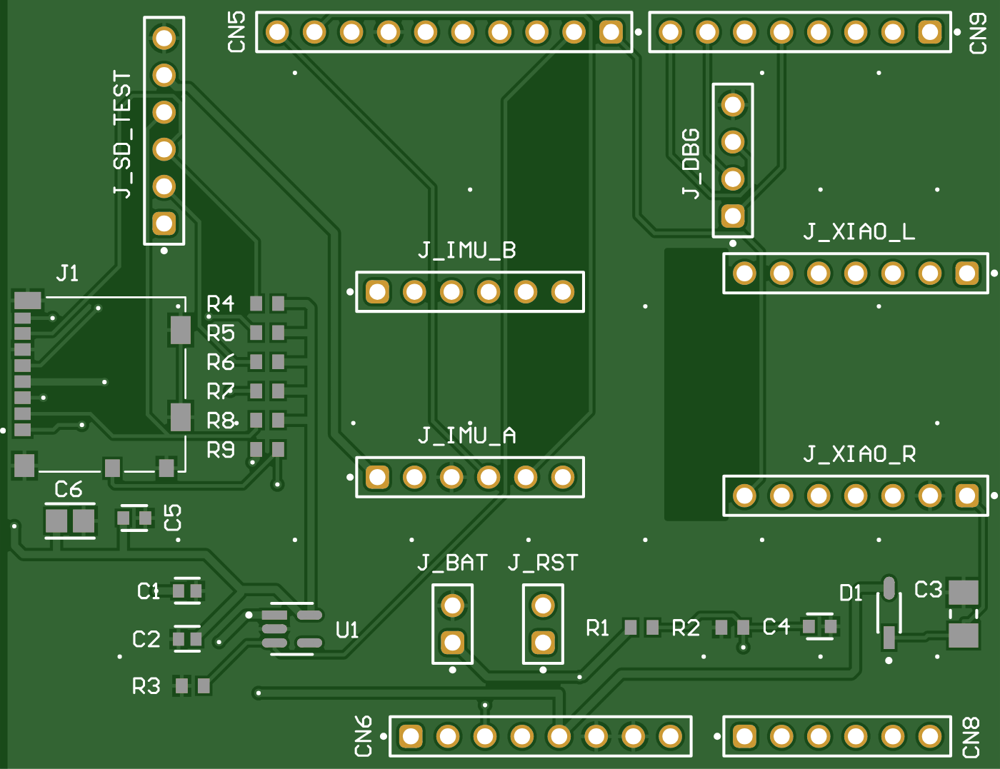
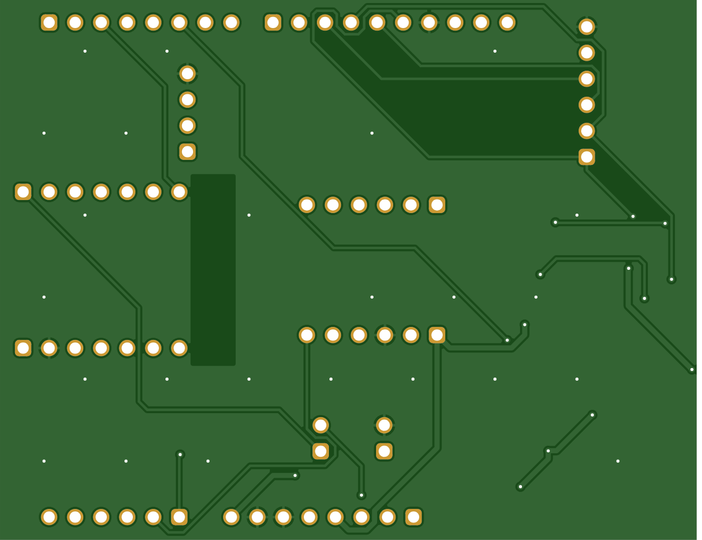
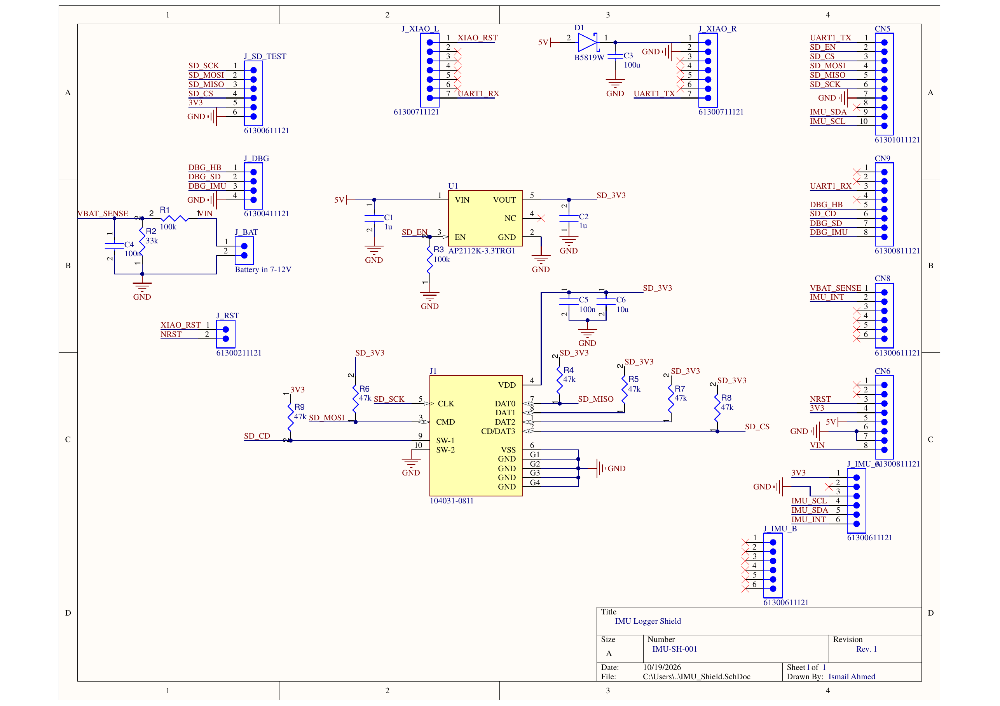

# IMU Logger Shield

A 2-layer shield PCB that plugs straight onto a **NUCLEO-F411RE** (STM32F411) and turns it into a self-contained motion logger: IMU over I²C, a microSD card over SPI, and a Seeed **XIAO ESP32-C3** as a wireless link.

Designed in **Altium Designer**. v1 is being fabricated and SMT-assembled by **JLCPCB** (see [Status](#status)).

Firmware lives in a separate repo: **[imu-logger-stm32](https://github.com/1ismai1/imu-logger-stm32)** (bare-metal / register-level STM32, FreeRTOS, DMA, FatFS on exFAT).

| Top | Bottom |
|---|---|
|  |  |

*Renders generated from the v1 Gerbers.*

## Schematic



Full PDF (schematic + layout): [docs/IMU_Shield.pdf](docs/IMU_Shield.pdf)

## Status

| Rev | Date | Status |
|---|---|---|
| v1 | Ordered 2026-10-14 | In fabrication, not yet tested on hardware |

## Board at a glance

- **Size:** 68.6 × 53.3 mm (Arduino Uno shield outline), 2 layers, ground pour on both sides
- **Mounts on:** NUCLEO-F411RE Arduino headers (CN5, CN6, CN8, CN9)
- **SMD parts:** sourced from LCSC / JLCPCB stock, assembled by JLCPCB
- **DRC:** 0 electrical violations (1 cosmetic: a silkscreen arc touches the board edge)

## What's on it

| Block | Parts | Notes |
|---|---|---|
| **microSD** | J1 Molex 104031-0811 socket | Bare socket on SPI1 (no breakout board). 47k pull-ups on CS, MOSI, MISO and the unused DAT1/DAT2 pins (R4–R8). Card-detect switch with 47k pull-up (R9). |
| **Switchable SD power** | U1 AP2112K-3.3 LDO, C1/C2 1µF, C5 100nF, C6 10µF | The SD card gets its own 3.3 V rail (`SD_3V3`). The MCU controls the LDO's enable pin (`SD_EN`), so firmware can **hard power-cycle a hung card**. R3 (100k) pulls EN low, so the card stays off until firmware turns it on. |
| **IMU** | J_IMU_A / J_IMU_B headers | Socket for the Adafruit MPU-6050 breakout on I²C1 + interrupt line. J_IMU_B carries no signals; it's there to hold the breakout steady. |
| **Wireless** | J_XIAO_L / J_XIAO_R headers, D1 B5819W, C3 100µF | XIAO ESP32-C3 talks to the STM32 over USART1. Powered from the Nucleo 5 V through a Schottky diode so the XIAO's own USB can't back-feed the Nucleo. |
| **XIAO → STM32 reset** | J_RST (2-pin jumper) | Jumper connects XIAO D0 to the STM32's `NRST`, so the ESP32 can reset the STM32 (groundwork for an over-the-air firmware update path). Pull the jumper to disconnect it. |
| **Battery input** | J_BAT (7–12 V), R1/R2 100k/33k divider, C4 100nF | Battery feeds the Nucleo `VIN` pin. The divider scales it to ≤ 3.0 V at 12 V for the ADC (`VBAT_SENSE`) so firmware can read battery voltage. |
| **Debug** | J_DBG (3 signals + GND) | Spare GPIOs (heartbeat, SD activity, IMU activity) brought out for a logic analyzer, to time the firmware on real hardware. |
| **SD test / fallback** | J_SD_TEST | SPI1 lines + 3.3 V + GND on a header, for probing the bus or plugging in an external SD breakout if the onboard socket misbehaves. |

## Pin map (shield → Nucleo → STM32)

| Signal | Nucleo pin | STM32 pin | Peripheral |
|---|---|---|---|
| `IMU_SCL` | D15 (CN5-10) | PB8 | I2C1_SCL |
| `IMU_SDA` | D14 (CN5-9) | PB9 | I2C1_SDA |
| `IMU_INT` | A1 (CN8-2) | PA1 | GPIO / EXTI |
| `SD_SCK` | D13 (CN5-6) | PA5 | SPI1_SCK |
| `SD_MISO` | D12 (CN5-5) | PA6 | SPI1_MISO |
| `SD_MOSI` | D11 (CN5-4) | PA7 | SPI1_MOSI |
| `SD_CS` | D10 (CN5-3) | PB6 | GPIO |
| `SD_EN` | D9 (CN5-2) | PC7 | GPIO (SD power on/off) |
| `SD_CD` | D5 (CN9-6) | PB4 | GPIO (card detect) |
| `UART1_TX` (STM32 → XIAO) | D8 (CN5-1) | PA9 | USART1_TX |
| `UART1_RX` (XIAO → STM32) | D2 (CN9-3) | PA10 | USART1_RX |
| `VBAT_SENSE` | A0 (CN8-1) | PA0 | ADC1_IN0 |
| `DBG_HB` | D4 (CN9-5) | PB5 | GPIO |
| `DBG_SD` | D6 (CN9-7) | PB10 | GPIO |
| `DBG_IMU` | D7 (CN9-8) | PA8 | GPIO |
| `NRST` | RESET (CN6-3) | NRST | Reset (via J_RST) |

USART2 (PA2/PA3, D0/D1) is left free for the ST-Link virtual COM port.

## Design notes / things to watch on bring-up

- **Battery power:** when powering from J_BAT, the Nucleo's power-source jumper (JP5) must be on **E5V**, not U5V.
- **SD power-cycling:** before pulling `SD_EN` low, set the SPI/CS pins low or to inputs. Otherwise the STM32 can partially power the "off" card through its I/O pins and pull-ups, and the reset won't be clean.
- **J_RST:** the XIAO pin should only ever pull `NRST` low or float (open-drain style). Driving it high while ST-Link resets the board makes the two fight.
- **C3 (100 µF, 6.3 V ceramic):** at 5 V, ceramics lose a lot of their rated capacitance (DC bias). Fine for v1; a higher-voltage part is a candidate for v2.

## Repo layout

```
IMU_Shield.PrjPcb            Altium project (open this)
IMU_Shield.SchDoc            Schematic
IMU_Shield.PcbDoc            PCB layout (footprints are stored inside it)
CAMtastic*.Cam               Altium Gerber-viewer sessions used to check the outputs
fabrication/v1/              Exactly what was sent to JLCPCB for v1
  IMU_Shield_Gerbers.zip       copper, mask, silk, paste, outline + drill
  IMU_Shield_BOM.xlsx / .csv   bill of materials with LCSC part numbers
  IMU_Shield_CPL.csv           pick-and-place (component positions and rotations)
docs/
  IMU_Shield.pdf               schematic + layout (no Altium needed)
  images/                      schematic and board renders
  DRC_report_v1.html           Altium design rule check
```

Altium's own working folders (`History/`, `Project Logs…/`, `Project Outputs…/`, `__Previews/`) are git-ignored; `fabrication/` holds the curated, as-ordered copy of the outputs.

## Opening the design

Open `IMU_Shield.PrjPcb` in Altium Designer. No external libraries are needed.
